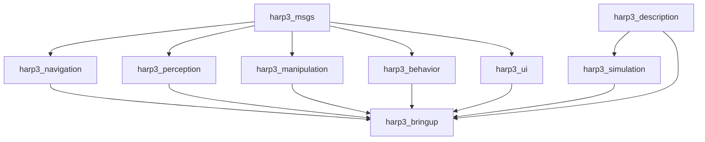
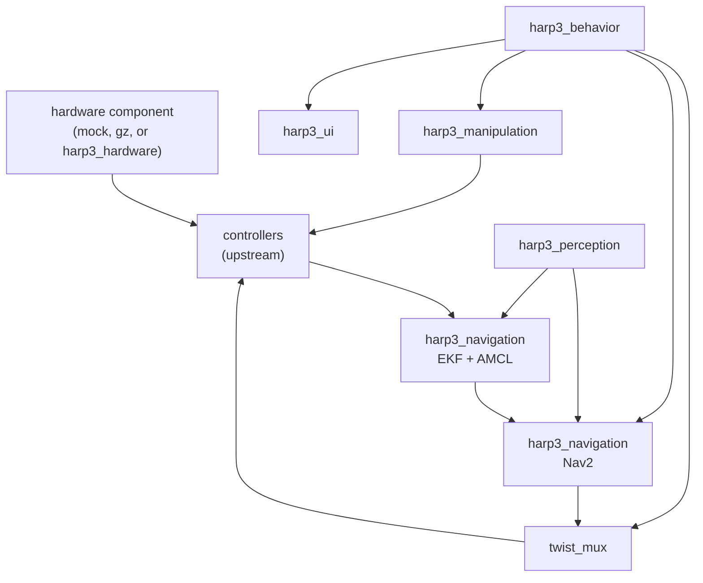

# Architecture

## Layers, and the two bands that cross them

```
┌───────────┐ ┌─────────────────────────────────────────────────┐ ┌────────────┐
│           │ │                      UI                         │ │            │
│           │ ├─────────────────────────────────────────────────┤ │  SAFETY    │
│ CONTRACTS │ │                   MISSION                       │ │            │
│           │ ├──────────────────────┬──────────────────────────┤ │  e-stop    │
│ msgs      │ │      Navigation      │      Manipulation        │ │  watchdogs │
│ descriptn │ ├───────────┬──────────┴───┬──────────────────────┤ │  collision │
│           │ │ Perception│  Estimation   │     Controllers      │ │  limits    │
│  crosses  │ ├───────────┴──────────────┴──────────────────────┤ │  crosses   │
│    the    │ │            Hardware Interface                    │ │    the     │
│   BUILD   │ ├─────────────────────────────────────────────────┤ │  RUNTIME   │
│           │ │                  Hardware                        │ │            │
└───────────┘ └─────────────────────────────────────────────────┘ └────────────┘
```

The two bands are symmetric, and that symmetry is the point. The left one is
depended upon by every layer at **build** time. The right one is consumed by every
layer at **run** time, over topics, and nothing links against it — which is what
lets a cross-cutting concern exist without inverting the dependency graph.

`harp3_simulation` replaces the two bottom layers at once. The safety band has no
package yet; where its pieces currently live is recorded in
[ADR 0006](adr/0006-deferred-packages.md).

## Two different graphs

Package layering is described twice below, because two distinct graphs are
routinely confused. The *build graph* is what `package.xml` declares and what
colcon orders the build with. The *runtime graph* is what data does at execution
time. An edge in one is not an edge in the other, and the whole design rests on
the runtime graph being deep while the build graph stays shallow.

### Build graph

Every edge below is declared in a `package.xml`. There are no others.



`harp3_msgs` and `harp3_description` depend on nothing local. `harp3_bringup`
depends on everything and nothing depends on it. Everything in between is mutually
independent: `harp3_navigation` does not link against `harp3_perception`, and
`harp3_manipulation` does not link against `harp3_navigation`.

That independence is the property worth protecting. Any package in the middle can
be rebuilt, replaced or dropped without touching its neighbours, and each can be
tested on the host in isolation.

### Runtime graph

The same packages form a pipeline, but every edge below is a topic, a service or
an action.



`harp3_bringup` appears in neither: it starts processes and then has no runtime
role at all.

## Frames, and one publisher per edge

```
map
 └── odom
      └── base_footprint
           └── base_link
                ├── laser_link
                ├── imu_link
                └── arm_base_link → … → tool_link
```

| Edge | Sole publisher |
| --- | --- |
| `map → odom` | AMCL |
| `odom → base_footprint` | the `robot_localization` EKF |
| `base_footprint → base_link` and below | `robot_state_publisher`, from the URDF |

Both of the first two live in `harp3_navigation`; see
[ADR 0005](adr/0005-navigation-owns-pose-estimation.md).

Because AMCL owns `map → odom`, there is only one EKF, not two: the global filter
that a beacon-based system would need does not exist here. And because the EKF owns
`odom → base_footprint`, the base controller runs with `enable_odom_tf: false` and
`base_frame_id: base_footprint`. Leaving the controller at its default is the
single most common way to break this stack.

## The hardware boundary

Two mechanisms exist for talking to a device, and picking the wrong one is
expensive to undo. The test is one question: **does the `controller_manager` update
loop need this value in order to compute the next command?**

If it does, the device is a `ros2_control` plugin — a `SystemInterface`,
`ActuatorInterface` or `SensorInterface` declared in the `<ros2_control>` block of
the xacro. It is loaded into the `controller_manager` process, its `read()` and
`write()` run inside the update loop, and it is bound by the real-time rules
below. Wheel motors, encoders, the IMU, the arm's actuators and the GPIO wired to
the microcontroller belong here.

If it does not, the device is a standalone `rclcpp_lifecycle::LifecycleNode`
publishing on `SensorDataQoS`, sampled asynchronously and consumed only by
estimation. A LiDAR, a camera or a beacon receiver belongs here — and only if it
has no upstream driver, since an upstream driver is an `exec_depend` and a
parameter file rather than a package.

See [ADR 0003](adr/0003-hardware-boundary.md). Neither package exists yet, for the
reason given in [ADR 0006](adr/0006-deferred-packages.md).

### The plugin is selected, not written

The `<ros2_control>` block declares the slots; a `hardware` xacro argument selects
what fills them.

| `hardware` | Plugin | Use |
| --- | --- | --- |
| `mock` | `mock_components/GenericSystem` | default; no physics, no Gazebo |
| `sim` | `gz_ros2_control/GazeboSimSystem` | Gazebo Jetty |
| `real` | `harp3_hardware/Harp3System` | the robot, once that package exists |

`mock_components/GenericSystem` mirrors commands to states and handles `<gpio>`
too, so the whole control stack — controllers, estimation, skills, mission — is
exercisable before any electronics exist. Everything above this boundary is written
once and is unaware of which plugin is loaded, which only holds as long as no
package above it depends on the hardware side at build time.

## Skills are peers

`harp3_navigation` and `harp3_manipulation` sit at the same level. Each exposes
actions defined in `harp3_msgs`, each drives the controllers, and neither depends
on the other. `harp3_behavior` is the only package that sequences them; see
[ADR 0004](adr/0004-manipulation-placement.md).

## Commands are arbitrated, not remapped

Three sources want the base: Nav2, the joystick and occasionally the behaviour
tree. `twist_mux` is the arbiter, its output remapped onto the base controller's
`cmd_vel`, with the joystick above navigation in priority and the emergency stop
wired as a lock rather than as a command source.

Since Jazzy, `~/cmd_vel` is required to be `geometry_msgs/TwistStamped` — the
`use_stamped_vel` parameter was removed from the controllers and Nav2 migrated too.
Anything still publishing bare `Twist` is silently ignored. `twist_mux` needs
`use_stamped: true` set explicitly, as it stopped being declared automatically in
version 4.5.0.

## Who owns launch files and parameters

Every package that produces runtime behaviour ships both the launch file that
starts it and the parameter file that configures it, in its own `launch/` and
`config/`. Nav2 parameters, the EKF and AMCL configuration and the map live in
`harp3_navigation`.

`harp3_bringup` composes and does not configure. Its `config/` holds only what no
single package can own: the `controller_manager` YAML, the `twist_mux`
arbitration, the joystick mapping and the diagnostics aggregation.

The two RViz configurations are not a duplicate. `harp3_description/rviz/` backs
the display launch that shows the model alone, with no stack running;
`harp3_bringup/rviz/` is the layout for the running robot.

## Startup order

A robot that commands before the hardware is active, or navigates before
localization has converged, fails in ways that are hard to diagnose. The order is:
`robot_state_publisher`, then the `controller_manager` and its hardware component,
then the controllers — `joint_state_broadcaster` first, then the base, then the arm
— then the sensors, then the EKF, then AMCL until it converges, then Nav2, then the
skills, and `harp3_behavior` last.

Sequencing is done with lifecycle transitions, never with `TimerAction` delays in a
launch file. A delay calibrated on a laptop fails on the robot.

## Processes

Three composable containers, not one and not twelve.

| Container | Contents | Rationale |
| --- | --- | --- |
| control | `controller_manager`, hardware component, controllers, `twist_mux` | the only real-time path, already one process by construction |
| sensing | sensor drivers, perception, EKF, AMCL, map server | zero-copy matters, scans and images circulate here |
| autonomy | Nav2 servers, manipulation, behaviour, UI | small messages; fault isolation is worth more than latency |

A crash in the behaviour tree must not take down the control loop. That is the
whole trade-off between intra-process performance and fault isolation.

## No shared utility package

There is deliberately no `harp3_common` or `harp3_utils`. Such a package starts as a
convenience, ends up being depended on by everything, and collapses the shallow
build graph that the first section exists to protect. Shared code belongs in the
lowest package that legitimately owns it.

This is stricter than the reference stacks: Nav2 ships `nav2_util`, `nav2_common`
and `nav2_ros_common`, and Clearpath ships `clearpath_common`. The rule is a
deliberate choice for a small team, not an industry convention.

## Node design

Nodes are classes deriving from `rclcpp::Node`, compiled into a shared library and
registered with `rclcpp_components_register_node`. This allows the whole stack to be
loaded into a single process, where intra-process communication avoids serialisation
and copying, while still allowing each node to be run separately during debugging.

Anything that owns hardware, or that must come up and go down in a defined order,
derives from `rclcpp_lifecycle::LifecycleNode` instead.

A `ros2_control` hardware component is neither: it is not a node, has no ROS
interface, and takes its configuration from `<param>` tags in the xacro rather than
from ROS parameters. It is the one place in this repository where the
`generate_parameter_library` rule does not apply.

## Real-time boundary

The `controller_manager` update loop is the only real-time path. Code inside it
performs no allocation, no locking and no logging. Data enters it from ROS callbacks
through `realtime_tools::RealtimeBuffer`. Everything outside that loop is
best-effort.

## Testability

The kinematics of the base and the arm, and the frame protocol of the microcontroller
link, are pure functions in libraries with no ROS dependency. They carry most of the
bugs and are testable on the host in milliseconds, which is what separating
computation from I/O is for.

Above that, `launch_testing` checks that the graph comes up and that each TF edge has
exactly one publisher, and a headless Gazebo run asserts that a full match completes
within its time limit.

## Decision records

Structural decisions are recorded in [`adr/`](adr).
